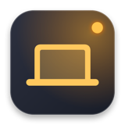
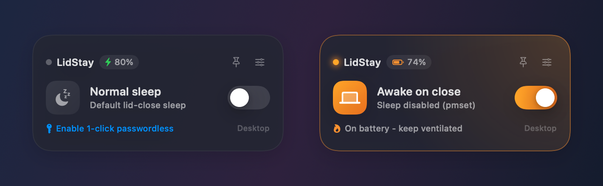

<div align="center">
  
  <h1>LidStay</h1>
  <p>A lightweight macOS desktop widget and menu bar utility for toggling <code>pmset -a disablesleep</code>.</p>
  <p>
    <strong>English</strong> | <a href="README.vi.md">Tiếng Việt</a>
  </p>
  <p>
    <a href="https://github.com/nightwalker89/LidStay/releases/latest">
      
    </a>
    
    
    
  </p>
</div>

<p align="center">
  
</p>
<p align="center">
  <em>Left: normal sleep on AC power. Right: closed-lid awake mode active on battery power.</em>
</p>

## Why LidStay

By default, macOS puts a MacBook to sleep as soon as you close the lid unless it is connected to AC power, an external display, and an external input device.
LidStay gives you a single desktop switch to toggle `pmset -a disablesleep` so your MacBook stays awake with the lid closed, even on battery and without an external monitor.

## Features

| Feature | Details |
| --- | --- |
| **Desktop Widget & Menu Bar** | Borderless translucent card (`LSUIElement`) that stays off the Dock and remembers its screen position. |
| **Live Kernel State** | Reads `SleepDisabled` directly from `IOPMrootDomain` and power/battery info from `IOPSCopyPowerSourcesInfo` every 2 seconds. |
| **1-Click Passwordless Toggle** | Prompts via macOS admin dialog by default, with an optional scoped `/etc/sudoers.d/lidstay-pmset` rule for instant 1-click switching. |
| **Desktop vs. Float Layer** | Pin button switches between the desktop layer (under app windows) and floating above windows. |
| **Low-Battery Safeguard** | Automatically restores normal sleep when battery drops to `<= 15%` while unplugged (requires 1-click passwordless mode). |
| **Launch at Login** | Enable or disable auto-start directly from the menu bar via `SMAppService.mainApp`. |

## Installation

### Download Prebuilt Universal App

1. Download `LidStay-v*-macOS-universal.dmg` or `.zip` from [GitHub Releases](https://github.com/nightwalker89/LidStay/releases/latest).
2. Drag `LidStay.app` into `/Applications`.
3. Because releases are ad-hoc signed, clear the quarantine attribute if macOS blocks the first launch:

```bash
xattr -cr /Applications/LidStay.app
open -a /Applications/LidStay.app
```

### Build from Source

Requires macOS 14.0+ and Xcode / Swift 6.0+.

```bash
# Build for the current Mac architecture and install to /Applications/LidStay.app
./build.sh

# Build a Universal Binary (Apple Silicon + Intel)
./build.sh --universal

open -a /Applications/LidStay.app
```

## How It Works

LidStay toggles the system-wide macOS sleep override across both AC and battery power:

```bash
# Enable closed-lid awake mode
sudo /usr/bin/pmset -a disablesleep 1

# Restore normal sleep
sudo /usr/bin/pmset -a disablesleep 0
```

When **1-click passwordless mode** is enabled from the widget or menu bar, LidStay validates a temporary sudoers file with `visudo -cf` and installs `/etc/sudoers.d/lidstay-pmset` with `0440` permissions scoped strictly to those two commands:

```text
<username> ALL=(root) NOPASSWD: /usr/bin/pmset -a disablesleep 0, /usr/bin/pmset -a disablesleep 1
```

You can remove this rule anytime from the widget settings popover or the menu bar.

## Safety Warning

- **Thermal risk**: Never put a closed MacBook into a bag, sleeve, or enclosed space while `disablesleep` is active, as it can overheat severely.
- **Battery drain**: On battery power, `disablesleep = 1` keeps the system awake until drained unless the low-battery safeguard (`<= 15%`) or a manual toggle restores normal sleep.

## Project Structure

- `Sources/LidStay/PowerManager.swift` - IOKit state polling, power source reading, `pmset` execution, and sudoers management
- `Sources/LidStay/FloatingWidgetPanel.swift` - Borderless `NSPanel`, desktop/float window level switching, and display bounds clamping
- `Sources/LidStay/WidgetView.swift` - SwiftUI widget card and quick settings popover
- `Sources/LidStay/AppDelegate.swift` - Menu bar item, widget lifecycle, and Launch at Login
- `Sources/LidStay/main.swift` - Accessory app entry point
- `scripts/make_icon.swift` - Generates `Resources/AppIcon.icns`
