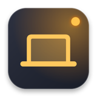
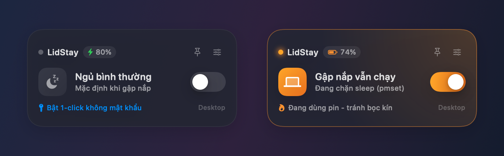

<div align="center">
  
  <h1>LidStay</h1>
  <p>Widget desktop và menu bar gọn nhẹ cho macOS để bật/tắt <code>pmset -a disablesleep</code>.</p>
  <p>
    <a href="README.md">English</a> | <strong>Tiếng Việt</strong>
  </p>
  <p>
    <a href="https://github.com/nightwalker89/LidStay/releases/latest">
      
    </a>
    
    
    
  </p>
</div>

<p align="center">
  
</p>
<p align="center">
  <em>Trái: chế độ ngủ bình thường khi cắm sạc. Phải: đang bật chặn sleep khi gập nắp lúc dùng pin.</em>
</p>

## LidStay giải quyết vấn đề gì

Mặc định trên macOS, MacBook sẽ sleep ngay khi bạn gập nắp trừ khi đang cắm sạc, cắm màn hình ngoài và cắm chuột/bàn phím ngoài (Clamshell Mode).
LidStay cung cấp công tắc trực tiếp trên desktop để bật/tắt `pmset -a disablesleep`, giúp máy vẫn chạy khi gập nắp ngay cả lúc dùng pin và không cắm màn hình ngoài.

## Tính năng

| Tính năng | Chi tiết |
| --- | --- |
| **Desktop Widget & Menu Bar** | Thẻ kính mờ không viền (`LSUIElement`), không chiếm Dock và tự nhớ vị trí kéo thả trên màn hình. |
| **Đọc trạng thái kernel trực tiếp** | Đọc `SleepDisabled` từ `IOPMrootDomain` và nguồn điện/pin từ `IOPSCopyPowerSourcesInfo` mỗi 2 giây. |
| **Bật 1-click không mật khẩu** | Mặc định dùng hộp thoại xác thực của macOS; tuỳ chọn cài rule `/etc/sudoers.d/lidstay-pmset` để gạt công tắc tức thì. |
| **Ghim tầng Desktop / Float** | Nút ghim chuyển đổi giữa tầng Desktop (nằm dưới cửa sổ app) và Float (nổi trên mọi cửa sổ). |
| **Tự bảo vệ khi pin yếu** | Tự khôi phục sleep bình thường khi pin giảm xuống `<= 15%` lúc rút sạc (hoạt động khi bật chế độ 1-click). |
| **Khởi động cùng macOS** | Bật/tắt tự chạy khi đăng nhập ngay trong tuỳ chọn widget hoặc menu bar (`~/Library/LaunchAgents`). |

## Cài đặt

### Tải bản build sẵn (Universal cho Apple Silicon & Intel)

1. Tải file `LidStay-v*-macOS-universal.dmg` hoặc `.zip` tại [GitHub Releases](https://github.com/nightwalker89/LidStay/releases/latest).
2. Kéo `LidStay.app` vào thư mục `/Applications`.
3. Vì bản release dùng chữ ký ad-hoc, nếu macOS chặn lần mở đầu tiên thì chạy lệnh xoá quarantine:

```bash
xattr -cr /Applications/LidStay.app
open -a /Applications/LidStay.app
```

### Tự build từ mã nguồn

Yêu cầu macOS 14.0+ và Xcode / Swift 6.0+.

```bash
# Build theo kiến trúc máy hiện tại và cài vào /Applications/LidStay.app
./build.sh

# Build bản Universal Binary (Apple Silicon + Intel)
./build.sh --universal

open -a /Applications/LidStay.app
```

## Cơ chế hoạt động

LidStay điều khiển cờ chặn sleep toàn hệ thống cho cả nguồn sạc lẫn pin:

```bash
# Bật chế độ gập nắp vẫn chạy
sudo /usr/bin/pmset -a disablesleep 1

# Khôi phục chế độ ngủ bình thường
sudo /usr/bin/pmset -a disablesleep 0
```

Khi bật **1-click không mật khẩu** trên widget hoặc menu bar, LidStay kiểm tra cú pháp bằng `visudo -cf` rồi ghi `/etc/sudoers.d/lidstay-pmset` với quyền `0440`, giới hạn chặt chỉ cho đúng 2 lệnh trên:

```text
<username> ALL=(root) NOPASSWD: /usr/bin/pmset -a disablesleep 0, /usr/bin/pmset -a disablesleep 1
```

Bạn có thể gỡ quyền này bất kỳ lúc nào ngay trong popover tuỳ chọn hoặc từ menu bar.

## Lưu ý an toàn

- **Quá nhiệt**: Tuyệt đối không bỏ MacBook đang gập nắp và bật `disablesleep` vào balo, túi chống sốc hoặc nơi kín gió.
- **Hao pin**: Khi rút sạc, `disablesleep = 1` sẽ giữ máy thức cho đến khi cạn pin nếu bạn tắt tính năng tự khôi phục ở mức `<= 15%` hoặc quên gạt tắt.

## Cấu trúc dự án

- `Sources/LidStay/PowerManager.swift` - Đọc trạng thái IOKit, nguồn pin, chạy `pmset` và quản lý sudoers
- `Sources/LidStay/FloatingWidgetPanel.swift` - Cửa sổ `NSPanel` không viền, chuyển tầng Desktop/Float và kẹp khung hình khi đổi màn hình
- `Sources/LidStay/WidgetView.swift` - Giao diện widget SwiftUI và popover tuỳ chọn nhanh
- `Sources/LidStay/AppDelegate.swift` - Biểu tượng Menu Bar, vòng đời widget và Launch at Login
- `Sources/LidStay/main.swift` - Điểm khởi chạy ứng dụng nền (`LSUIElement`)
- `scripts/make_icon.swift` - Tạo bộ icon `Resources/AppIcon.icns`
